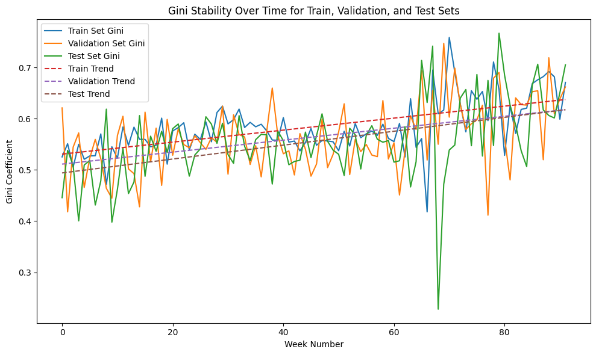
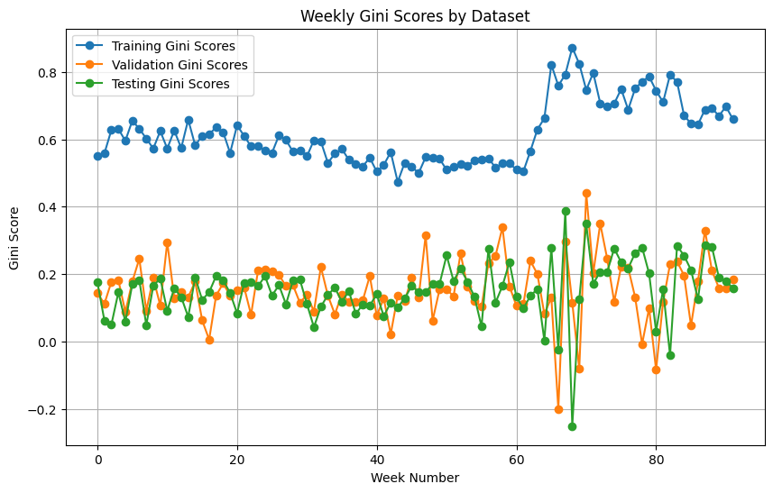

# Predicting loan default with models that stay stable over time

[](https://github.com/Bra-AM/erdos-homecreditmodelstability/actions/workflows/tests.yml)

When a lender decides whether to approve a loan, it relies on a model that
ranks applicants by how likely they are to default. These models are expensive
to build and validate, so once they're in production they tend to stay there
for a long time. That's a problem if the model quietly gets worse as the people
applying, and the economy around them, change.

In 2024 Home Credit, a consumer lender that serves many people with little or
no credit history, ran a
[Kaggle competition](https://www.kaggle.com/competitions/home-credit-credit-risk-model-stability)
around exactly this question. A model wasn't judged only on how well it ranks
applicants, but on whether it keeps doing so week after week. I worked on it
with Sze Hong Kwong during the Spring 2024
[Erdos Institute](https://www.erdosinstitute.org/) Data Science Boot Camp
([project page](https://www.erdosinstitute.org/project-database/spring-2024/data-science-boot-camp/home-credit---credit-risk-model-stability-ii),
[executive summary](reports/executive_summary_spring_2024.pdf)).

## The data

The training set has about 1.5 million loan applications decided between
January 2019 and October 2020, and roughly 3% of them defaulted. The data isn't
one tidy table. It's a set of related tables linked by an application ID: the
application itself, information from a credit bureau, the applicant's previous
applications, and the people attached to each loan. Some of these tables have
many rows per application, so they have to be summarised (a maximum, a count,
an "any late payment?") before everything can be joined into one row per
application. Missing values are everywhere: only about 3.5% of applicants have
a risk assessment from the credit bureau, for example.

## How performance is measured

The competition uses a metric built on the Gini coefficient (`2·AUC − 1`), a
standard measure in credit scoring of how well a score separates defaulters
from everyone else. The twist is that it's computed separately for every week
of decisions. A straight line is fitted through the weekly values, and the
final score is

```
stability = mean(weekly Gini) + 88 · min(0, slope) − 0.5 · std(residuals)
```

So a model gets credit for ranking applicants well on average, loses a lot if
its performance trends downward over time, and loses a little if it bounces
around from week to week. Getting better over time earns nothing extra. I
implemented the metric in [`src/creditrisk/metrics.py`](src/creditrisk/metrics.py)
and tested it against the competition's reference code.

## What we did

We started by pulling features out of the different tables and looking at how
they relate to default ([notebook 01](notebooks/01_data_cleaning_eda_feature_engineering.ipynb)).
Most individual features turned out to be only weakly related to default on
their own. Income, monthly payment and total debt look almost the same for
people who defaulted and people who didn't. The strongest single signal was
the credit bureau's own risk estimate, which comes as text like `"6% - 8%"`. We
converted it into a number, but it only exists for a small share of applicants.

From there we tried three kinds of model:

* **XGBoost** ([notebook 02](notebooks/02_xgboost.ipynb),
  [notebook 03](notebooks/03_xgboost_feature_ablation_and_baseline.ipynb)),
  a gradient-boosted tree model, with class weighting to handle the fact that
  defaults are rare. It was compared against a random-forest baseline and
  against versions without the engineered features.
* **A neural network** ([notebook 04](notebooks/04_mlp.ipynb)), a scikit-learn
  MLP behind a pipeline that fills in missing values, flags where they were
  missing, scales numeric columns and one-hot encodes categories.
* **LightGBM** ([notebook 05](notebooks/05_lightgbm.ipynb)), another
  gradient-boosted tree model, using 70 features and early stopping. It started
  from the competition's public starter notebook, and I built the evaluation
  and the over-time analysis around it.

Each model was trained on 60% of the applications, tuned on 20% and tested on
the remaining 20%.

## Results

LightGBM worked best for us:

| | Neural network | LightGBM |
|---|---|---|
| AUC, train | 0.796 | 0.792 |
| AUC, validation | 0.595 | 0.782 |
| AUC, test | 0.591 | **0.778** |
| Stability, train | 0.577 | 0.562 |
| Stability, validation | 0.109 | 0.534 |
| Stability, test | 0.111 | **0.521** |

What I like about the LightGBM result is how close the training and test
numbers are: an AUC of 0.792 on data it had seen versus 0.778 on data it hadn't.
The weekly picture tells the same story:



The three curves follow each other closely, and the trend line slopes slightly
upward, so the model isn't penalised for decaying. The noticeable change is
around week 60, which is March 2020. From then on the weekly scores get much
noisier, which lines up with the start of the COVID-19 pandemic and is where
most of the stability penalty comes from.

The neural network is a useful contrast:



It does well on the weeks it trained on and much worse on new applications.
Part of the reason is that it was given the decision date, month and week as
inputs, so it could memorise how risky particular periods were, and that
doesn't carry over to new data. The tree models, working from the actual
credit history, held up much better.

The features LightGBM relied on most were the applicant's history of late
payments, the total amount they had already repaid, the reason their last
application was rejected, and the price of the credit
([chart](reports/figures/lightgbm_feature_importance.png)). In other words,
past repayment behaviour matters most, which is what you'd hope to see.

## Running the code

The data isn't included in this repository. It has to be downloaded from Kaggle
after accepting the competition rules; [`data/README.md`](data/README.md)
explains how, and `scripts/download_data.sh` does the download once you have a
Kaggle API token. It's about 4 GB.

```bash
git clone https://github.com/Bra-AM/erdos-homecreditmodelstability.git
cd erdos-homecreditmodelstability
pip install -r requirements.txt
pip install -e .

pytest                           # the tests use synthetic data, no download needed
bash scripts/download_data.sh
```

The notebooks are in `notebooks/`, numbered in the order they're meant to be
read, with a short guide in [`notebooks/README.md`](notebooks/README.md). The
pieces worth reusing (loading and joining the tables, the engineered features,
the stability metric and the train/test splits) are in a small package under
`src/creditrisk/`, with tests in `tests/`.

```python
from creditrisk import metrics, splits

train, valid, test = splits.random_split(applications)
test = test.assign(score=model.predict_proba(test[features])[:, 1])
metrics.stability_components(metrics.weekly_gini(test))
# {'mean_gini': ..., 'slope': ..., 'residual_std': ..., 'stability': ...}
```
